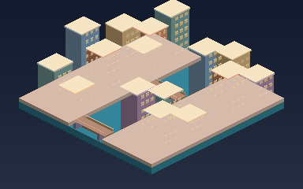
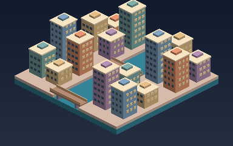

# SixBridge

SixBridge tests a small part of Xbox-to-Windows graphics compatibility. When several fragments write to one texel, which fragment wins? This Rust probe runs two compute passes, reads the result back and checks every 64-bit key against an independent CPU reference.

| Independent word maxima (broken control) | Two-pass resolve (GPU readback) |
|:---:|:---:|
|  |  |

The canal district is original test geometry. It contains **113,961 fragment contributions** across **92,160 texels**. On both Windows Direct3D 12 (Microsoft Basic Render Driver) and Linux Vulkan (SwiftShader), the broken control corrupted **18,566** texels. The two-pass result matched the CPU on **all 92,160**. The test compares both words of every key, including pixels outside the geometry.

## Run on Windows

Download the [tested Windows x64 build](https://github.com/Berserk-hub150/SixBridge/actions/runs/45493210827/artifacts/14968300942), extract the ZIP, then run this command from its root. The [Windows run](https://github.com/Berserk-hub150/SixBridge/actions/runs/45493210827) records the adapter and mismatch counts.

```powershell
.\target\release\sixbridge.exe --software
```

To build from source, install the stable Rust MSVC toolchain and Visual Studio C++ Build Tools. Run these commands from the repository directory.

```powershell
cargo test --locked
cargo run --release --locked
```

Windows selects Direct3D 12. To request the software adapter, run `cargo run --release --locked -- --software`. Linux selects Vulkan. Use `--out DIRECTORY` after Cargo's `--` separator to change the output directory. The program prints the actual adapter and backend, produces GPU, reference and deliberately broken PNGs under `output/`, and exits unsuccessfully on a mismatch. A Windows workflow runs the probe and attaches the executable and images to successful runs.

## Why two passes?

Each input record contains a texel index and an unsigned 64-bit key. The scene packs depth into the top 32 bits and a material color into the bottom 32. A larger depth wins. Equal depths use the larger low word as a deterministic tie-break.

Suppose one fragment offers `0x00000001_FFFFFFFF` and another offers `0x00000002_00000000`. Maximizing the halves independently invents `0x00000002_FFFFFFFF`, combining two different fragments. The first compute pass finds the largest high word at each texel. In a separate compute pass, only fragments matching that high word compete for the low word. Across both passes the shader uses 32-bit storage-buffer atomics. The corpus also tests collisions across workgroups, reversed input order, unsigned extremes, empty batches and untouched texels.

## Integration boundary

VIctory's November 23 status report listed 64-bit image atomics as a world-shader gap. Its shader emitter at revision `70564ae` already emits native 64-bit operations for typed resources on capable devices. SixBridge explores a fallback for a narrower operation, the **final unsigned maximum over a replayable batch** with zero-initialized output. Its Rust API is `gpu::Reducer::reduce(texel_count, &fragments)`. A caller with an initial image can include its current keys as candidates before reduction. The input and output must fit one device storage binding and the batch must fit one dispatch.

A runtime can use this strategy only if it can collect the candidates, guarantee that no shader observes intermediate values or the previous atomic value, and schedule both passes before a consumer reads the result. A shader requiring the original interleaving, immediate return values, signed comparisons or arbitrary image atomics needs a different implementation. Fragment generation and projection in this probe run on the CPU. Visibility resolution runs on the selected graphics backend. Runtime integration and execution of GTA VI remain open work.

[Upstream status](https://github.com/Marvisak/VIctory) · [Native atomic lowering at the inspected revision](https://github.com/Marvisak/VIctory/blob/70564ae08c82d43df5fad97b08d34628b07b1d9d/crates/victory-shader/src/emit/lower.rs#L7404-L7507) · [Microsoft's shader model 6.6 atomic specification](https://microsoft.github.io/DirectX-Specs/d3d/HLSL_SM_6_6_Int64_and_Float_Atomics.html)

MIT licensed. All fixture geometry and shader code in this repository are original.
